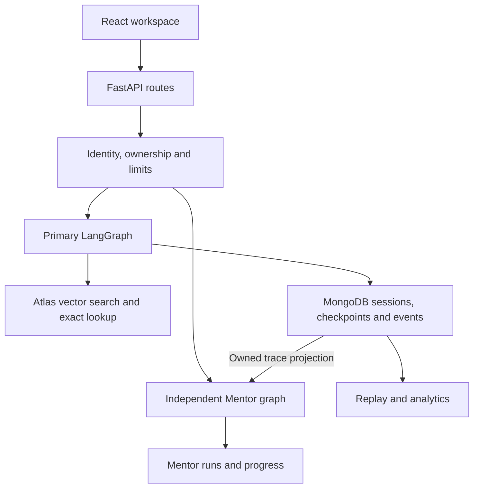
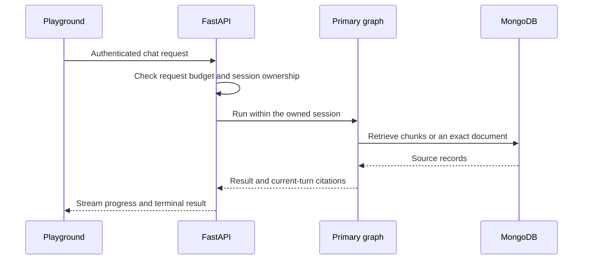

<div align="center">
  <a href="https://www.credly.com/badges/9b5d068b-0566-479f-812b-93b06d01041b">
    
  </a>
</div>

<div align="center">

# MongoDB AI Agent Platform

### Ask a MongoDB question, inspect the sources behind the answer, and replay how the agent got there.

A source-grounded agent workspace and an independent Mentor, built around the MongoDB University course **Building AI Agents with MongoDB**.

[](https://github.com/DharmiSapariya/AI-Agents-with-MongoDB-Certification/actions/workflows/ci.yml)


[**Run it**](#run) · [Workspace preview](#workspace-preview) · [Architecture](#architecture) · [Evaluation](#live-retrieval-evaluation) · [Release evidence](docs/RELEASE_EVIDENCE.md) · [Certificate](#certification)

</div>

---

## At a glance

| | |
|---|---|
| **The idea** | Make the source and execution behind an agent answer inspectable in the same workspace. |
| **Primary agent** | LangGraph routes between the model, Atlas Vector Search, and exact document lookup. The API validates citation IDs against evidence retrieved for that turn. |
| **Mentor** | A separate deterministic LangGraph explains recorded events, walks through traces, and tracks lessons, quizzes, and challenges. |
| **State** | MongoDB stores user-owned sessions, checkpoints, notes, execution events, and learning progress. |
| **Verified** | The release passed 292 backend tests and 7 frontend tests. Chromium walkthroughs and hosted Docker demo checks passed. |
| **Still to verify live** | Atlas retrieval, Voyage and OpenAI calls, real MongoDB checkpoint restoration, and benchmark scores. |

## The problem

A chat interface can show an answer while leaving the retrieval process invisible. If you ask, “Can I query on the first field of a compound index by itself?”, the answer alone leaves several questions open. Which chunk was retrieved? Did the agent search the corpus or look up a full document? Did a tool fail? Could another person inspect the same run and understand what happened?

The platform gives the answer, its citation metadata, and the saved execution separate surfaces. The Mentor reads the recorded execution through an owner-scoped view and explains the events without running the primary tools again.

## Workspace preview

[](docs/RELEASE_EVIDENCE.md#browser-captures)

The screenshot was captured in Chromium with a clearly labeled scripted primary run. The [release evidence](docs/RELEASE_EVIDENCE.md#browser-captures) also includes the Mentor and credential-free Project Resources screens.

| View | What you can inspect or do |
|---|---|
| **Agent Playground** | Send a question, follow server-sent progress, inspect evidence, and resume an owned conversation. |
| **Execution Replay** | Step through saved graph and tool events, then open the run in Mentor. |
| **Memory Studio** | Save, inspect, and delete personal notes. Opt in to use them on a chat turn. |
| **MongoDB Explorer** | Browse allowlisted collection samples through the API, including owned records and shared corpus metadata. |
| **Analytics** | Review recorded run counts, errors, tool latency, and provider token totals when available. |
| **Mentor Learning Center** | Study concepts, watch or step through a trace, take a quiz, and complete code-based challenges. |
| **Project Resources** | Open setup and credential links or import a retrieval report locally. |

## Architecture



### From question to cited answer



1. **Accept the request.** FastAPI checks the request-size cap and applicable budgets. The verified account owns the server-generated session ID.
2. **Retrieve evidence.** The primary agent can run vector search over chunks or fetch a full page by title. Tool events are recorded for replay.
3. **Resolve citations.** Citation IDs must refer to documents returned during the current run. The API distinguishes `answered`, `insufficient_evidence`, and `retrieval_failed`. Citation validation establishes provenance. Claim-level support still needs evaluation.
4. **Replay the run.** Saved events show observable decisions, tool calls, and outcomes. The Mentor turns an allowlisted view of those events into recorded facts and separate explanatory steps.

See the [architecture decisions](docs/ARCHITECTURE_DECISIONS.md), [route policy](docs/IMPLEMENTATION_STATUS.md), and [operations guide](docs/OPERATIONS.md).

## What happens when things go wrong

| Situation | Observable behavior |
|---|---|
| A caller supplies someone else’s session or execution ID | Owner-scoped reads return the same 404 as an unknown ID. |
| An answer cites an invented or earlier-turn ID | The answer fails current-turn citation validation. |
| The vector index is absent, incompatible, or building | The retrieval path reports index unavailability. The graph records the tool failure. |
| A request exceeds its byte cap or budget | The API returns 413 or 429. Rate-limit responses include retry timing where available. |
| A client disconnects during streaming | Progress delivery stops. A synchronous graph run already in progress can still finish and save its turn. |
| The trace is incomplete | Replay surfaces missing events or an incomplete terminal record. Unreported token usage stays unavailable. |

## Verification and results

| Check | Observed result | Scope |
|---|---|---|
| Backend suite | **292 passed, 1 skipped**, with Ruff and Mypy passing | Local tests use fixtures such as mongomock, a scripted model, and an in-memory checkpointer. |
| Frontend suite | **7 passed**, with a successful TypeScript and Vite production build | Clean npm install and local build. |
| Chromium walkthrough | Credential-free Resources and signed-in Playground-to-Mentor flows passed | The signed-in primary answer and retrieval events came from a labeled scripted fixture. |
| Hosted CI | Backend, frontend, and container smoke jobs passed | Docker demo startup and the React-to-FastAPI gateway were exercised. |
| Live retrieval benchmark | Runner and report viewer implemented | No live Atlas benchmark scores are bundled. |

[GitHub Actions](https://github.com/DharmiSapariya/AI-Agents-with-MongoDB-Certification/actions/workflows/ci.yml) · [Release evidence and screenshots](docs/RELEASE_EVIDENCE.md)

## Run

Use Python 3.12 and Node.js 22.12 or newer. From the repository root, start FastAPI:

```bash
python3.12 -m venv .venv
source .venv/bin/activate
make install
APP_MODE=demo make run
```

In a second terminal, start React:

```bash
cd frontend/playground
npm ci
npm run dev
```

Open the [React workspace](http://localhost:5173) for Project Resources. The [original FastAPI page](http://localhost:8000) includes public lessons and the quiz. To use the authenticated workspace, follow the [live walkthrough](docs/DEMO.md#live-walkthrough).

### Docker Compose

```bash
docker compose -f deployment/docker-compose.yml up --build --wait
```

Open [React on port 8080](http://127.0.0.1:8080) or the [legacy page on port 8000](http://127.0.0.1:8000). The services bind to loopback. The [operations guide](docs/OPERATIONS.md) covers environment variables, health checks, and reverse-proxy settings.

### Run the checks

```bash
make test
cd frontend/playground
npm test
npm run build
```

## Live retrieval evaluation

Use isolated Atlas corpus and checkpoint databases. Set `MONGODB_URI`, `DB_NAME`, `CHECKPOINT_DB`, and `VOYAGE_API_KEY` locally. The agent strategy also requires `OPENAI_API_KEY`. Use `JWT_SECRET` for authenticated app runs. See the [setup and ingestion steps](docs/DEMO.md#live-walkthrough).

```bash
python scripts/ingest_documents.py benchmarks/retrieval/corpus
python scripts/create_vector_index.py --wait-seconds 120
python scripts/evaluate_retrieval.py --strategy vector --top-k 5 --output-dir benchmark-results
python scripts/evaluate_retrieval.py --strategy agent --top-k 5 --output-dir benchmark-results --allow-agent-writes
```

The reports identify the dataset by hash and record the model, index, threshold, revision, and per-case failures. Run both strategies against the same corpus and settings. **Vector rank** is search order. **Agent rank** is citation order. Recall@k and MRR@k compare the sources each approach surfaces. Failed answerable cases count as zero and are reported separately.

Import a run’s JSON in **Project Resources** to inspect the metrics without uploading the file.

## Verification still open

- Run the authenticated walkthrough against a real Atlas corpus with Voyage and OpenAI.
- Confirm the previous turn survives a full FastAPI restart and run the opt-in real MongoDB checkpoint test.
- Record comparable live retrieval runs before reporting quality or latency figures.
- Verify proxy behavior on the intended deployment. Application rate counters are process-local.

## Repository map

| Location | Purpose |
|---|---|
| [`backend/app`](backend/app) | FastAPI routes, auth, primary and Mentor graphs, retrieval, and tracing |
| [`backend/tests`](backend/tests) | API, ownership, graph, and security regressions |
| [`frontend/playground`](frontend/playground) | React and TypeScript workspace |
| [`scripts`](scripts) | Ingestion, index setup, and evaluation commands |
| [`benchmarks/retrieval`](benchmarks/retrieval) | Versioned retrieval cases and sample corpus |
| [`deployment`](deployment) | Dockerfiles, Compose, and streaming gateway |
| [`docs`](docs) | Demo, operations, architecture, and release evidence |

## Certification

**Building AI Agents with MongoDB** is a MongoDB University course. The badge at the top and the Proof of Completion below are the official credentials. Learning progress inside Mentor is tracked by this project.

[MongoDB University curriculum](https://github.com/mongodb-university/curriculum/tree/main/AI-Agents-with-MongoDB/01-Building-AI-Agents-with-MongoDB) · [Verify the badge on Credly](https://www.credly.com/badges/9b5d068b-0566-479f-812b-93b06d01041b) · [Download the certificate PDF](assets/certification/mongodb-ai-agents-certificate.pdf)

<div align="center">
  <a href="assets/certification/mongodb-ai-agents-certificate.pdf">
    
  </a>
</div>
