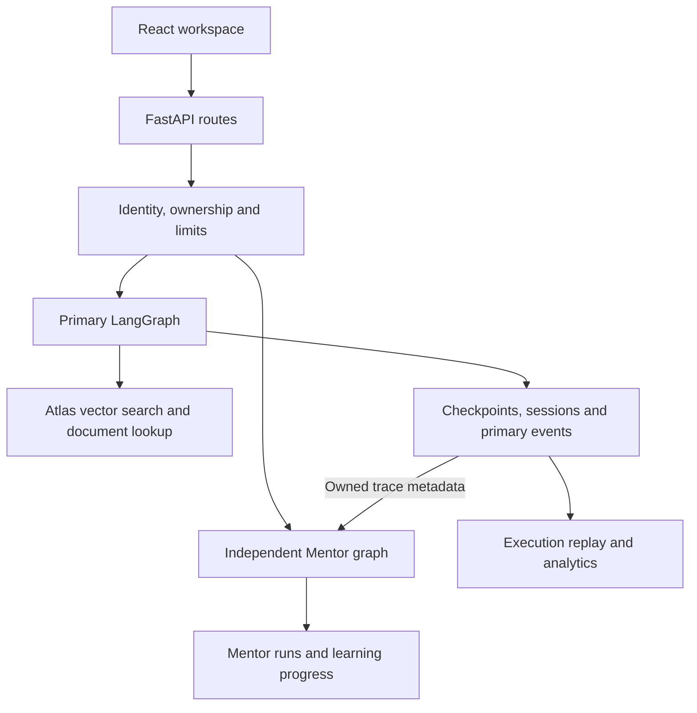

# MongoDB AI Agent Platform

A React workspace for asking MongoDB questions, inspecting cited documents,
and replaying agent executions. The primary LangGraph agent uses Atlas Vector
Search and exact document lookup. A separate, deterministic Mentor workflow
teaches course concepts and walks through recorded executions.

[Run locally](#run) · [Demo walkthrough](docs/DEMO.md) · [Architecture](#architecture) · [Release evidence](docs/RELEASE_EVIDENCE.md) · [Certification](#certification)

## What you can do

| Workspace | What it shows |
|---|---|
| Agent Playground | Authenticated streaming chat, owned conversation history, and current-turn citation metadata |
| Execution Replay | Saved graph events with playback controls and a direct link to Mentor |
| Memory Studio | User-managed notes that can be included in a chat turn by opting in |
| MongoDB Explorer and Analytics | Allowlisted collection samples, recorded run counts, tool timing, and reported token usage |
| Mentor Learning Center | Lessons, trace walkthroughs, quizzes, challenges, and account-scoped progress |
| Project Resources | Setup, curriculum and credential links, plus a local evaluator-report viewer |

## Workspace preview

[](docs/RELEASE_EVIDENCE.md#browser-captures)

The screenshot is from a Chromium walkthrough with a scripted primary run.
See [release evidence](docs/RELEASE_EVIDENCE.md) for the verification boundary.

## Run

Use Python 3.12 and Node.js 22.12 or newer. From the repository root, start
FastAPI in one terminal:

```bash
python3.12 -m venv .venv
source .venv/bin/activate
make install
APP_MODE=demo make run
```

In another terminal, start React:

```bash
cd frontend/playground
npm ci
npm run dev
```

Open [the React workspace](http://localhost:5173). Demo mode runs without
credentials. The React project resources are available, and the original
FastAPI page at [port 8000](http://localhost:8000) offers public lessons
and the quiz. Authenticated chat, memory, and execution views need a configured
backend. Follow the [demo walkthrough](docs/DEMO.md) for both paths.

### Run with Compose

```bash
docker compose -f deployment/docker-compose.yml up --build --wait
```

React is served at [port 8080](http://127.0.0.1:8080), with FastAPI at
[port 8000](http://127.0.0.1:8000). See the [operations guide](docs/OPERATIONS.md)
for environment configuration, readiness, rate limits, and proxy assumptions.

## Architecture



The primary graph alternates between the model and retrieval tools. The
server resolves citation IDs against evidence retrieved in the current turn.
That verifies source provenance. Evaluating whether the evidence supports a
particular claim is a separate step.

The Mentor reads an allowlisted projection of an owned trace and keeps
recorded fields separate from explanatory text. The [architecture decisions](docs/ARCHITECTURE_DECISIONS.md)
and [implementation status](docs/IMPLEMENTATION_STATUS.md) cover the design
and route-level policies.

## Live retrieval evaluation

Use an isolated Atlas corpus and checkpoint database. Set `MONGODB_URI`,
`DB_NAME`, `CHECKPOINT_DB`, and `VOYAGE_API_KEY` in your environment. The
agent strategy additionally requires `OPENAI_API_KEY`. Live account routes
also need `JWT_SECRET`. See the [live setup steps](docs/DEMO.md#live-walkthrough).

```bash
python scripts/ingest_documents.py benchmarks/retrieval/corpus
python scripts/create_vector_index.py --wait-seconds 120
python scripts/evaluate_retrieval.py --strategy vector --top-k 5 --output-dir benchmark-results
python scripts/evaluate_retrieval.py --strategy agent --top-k 5 --output-dir benchmark-results --allow-agent-writes
```

The two reports use the same case set. Vector rank is search order and agent
rank is citation order. Recall@k and MRR@k measure the sources each approach
surfaces. Reports retain run and dataset metadata and separate failed cases
from no-evidence results. Import a report under **Project Resources**. No live
benchmark scores are bundled.

## Verification

```bash
make test
cd frontend/playground
npm test
npm run build
```

See the [release evidence](docs/RELEASE_EVIDENCE.md) for checks performed
against a clean checkout and the current limits of live verification.

## Certification

This project accompanies the **Building AI Agents with MongoDB** course from
MongoDB University. The MongoDB Skill badge and Proof of Completion are
official credentials. Mentor activity and progress belong to this project.

[](https://www.credly.com/badges/9b5d068b-0566-479f-812b-93b06d01041b)

[Proof of Completion PDF](assets/certification/mongodb-ai-agents-certificate.pdf) · [MongoDB University curriculum](https://github.com/mongodb-university/curriculum/tree/main/AI-Agents-with-MongoDB/01-Building-AI-Agents-with-MongoDB)
