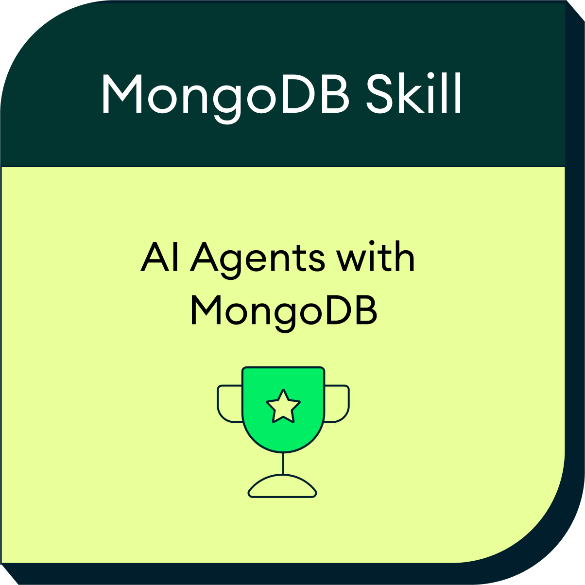
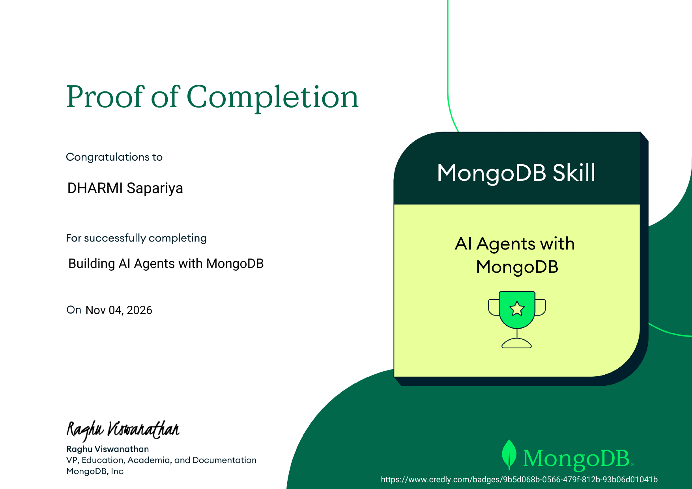

<!-- ============ TOP OF README (hero badge) ============ -->
<p align="center">
  <a href="https://www.credly.com/badges/9b5d068b-0566-479f-812b-93b06d01041b">
    
  </a>
</p>

<p align="center">
  <a href="https://www.credly.com/badges/9b5d068b-0566-479f-812b-93b06d01041b">
    
  </a>
</p>


# MongoDB AI Agent Platform

A MongoDB-backed multi-tool AI agent (LangGraph + Atlas Vector Search + MongoDB checkpointing), with a second **Mentor** component that explains Agent One's *recorded* execution traces. Based on the MongoDB University course *Building AI Agents with MongoDB*.

<!-- ============ CERTIFICATION SECTION (place after the intro / problem statement) ============ -->
## 🏅 Certification

This project builds on the official **MongoDB Skill badge: AI Agents with MongoDB**, earned by completing the *Building AI Agents with MongoDB* course on MongoDB University.

| | |
|---|---|
| **Credential** | MongoDB Skill: AI Agents with MongoDB |
| **Course** | Building AI Agents with MongoDB |
| **Issued by** | MongoDB, Inc. |
| **Completed on** | November 4, 2026 |
| **Verify** | [Credly badge](https://www.credly.com/badges/9b5d068b-0566-479f-812b-93b06d01041b) |

<p align="center">
  <a href="https://www.credly.com/badges/9b5d068b-0566-479f-812b-93b06d01041b">
    
  </a>
  &nbsp;&nbsp;&nbsp;
  <a href="assets/certification/mongodb-ai-agents-certificate.pdf">
    
  </a>
</p>

<p align="center">
  <sub>Click the badge to verify on Credly · Click the certificate to open the PDF</sub>
</p>

> **Note:** The badge and Proof of Completion above are the *official* credentials issued by MongoDB.
> Any achievements or completion marks inside this application's Certification page are
> project-generated learning milestones and are not MongoDB credentials.

## Status (honest)

| Area | Status |
|---|---|
| Agent One: 2 course tools, LangGraph loop, conditional routing, MongoDB checkpointer | IMPLEMENTED BUT NOT VERIFIED (needs Atlas + OpenAI + Voyage keys) |
| Event tracing to `agent_execution_events` with redaction and "fully_recorded" flag | IMPLEMENTED; redaction/tracer logic unit-tested, live DB path not verified |
| Agent Two (Mentor): static concept text, rule-based trace explanation, 3-question quiz | IMPLEMENTED; unit-tested. It is not an LLM agent: no model, graph or per-user history |
| Ingestion (embed-then-write, batched, resumable by hash + chunk count) | Logic tested with mongomock and a fake embedder; real Voyage/Atlas run NOT VERIFIED |
| Vector index and regular index scripts | IMPLEMENTED BUT NOT VERIFIED against Atlas |
| Frontend | PARTIAL: one static page (chat + mentor), trace data HTML-escaped |
| Accounts and access tokens (`/api/auth/register`, `/login`, `/me`) | VERIFIED LOCALLY against mongomock (151 tests); not run against Atlas |
| Per-user sessions, traces and explorer scoping | VERIFIED LOCALLY against mongomock (174 tests); not run against Atlas. Chat, sessions, executions, Mentor explain and the explorer require a token and only return the caller's records |
| Rate limits and request size caps | VERIFIED LOCALLY: 238 tests with a fake clock, plus a real uvicorn run in demo mode (200, 429, 413). Counters are per process; not tested behind a proxy, with several workers, or against Atlas |
| Long-term memory, SSE live updates, observability dashboard, DB explorer UI, benchmarks, step-through playback, learning-center modules, React frontend | NOT IMPLEMENTED |
| Direct dependencies pinned; CI runs ruff, mypy and pytest | Pinned versions install cleanly and pass locally; CI has not been observed running on GitHub; no lockfile for transitive packages |
| Startup settings validation, JSON logging, request IDs, MongoDB lifecycle, health states, standard error responses | IMPLEMENTED; covered by mocked tests (fake clients, mongomock), not run against Atlas |

A small original retrieval corpus is included for evaluation. The official course dataset is separate.

## Run
```bash
make install && make test   # no keys needed; tests use mongomock and a scripted model
make run                    # demo at http://localhost:8000
```
Without keys the app runs in **demo mode**: mentor teaching and quiz work; agent, traces and DB views return 503 with code `demo_mode`.

### Live retrieval evaluation

From the repository root, export `MONGODB_URI`, `VOYAGE_API_KEY`, and
`DB_NAME` for an isolated Atlas database using your local secret manager.
The database account needs corpus write access for ingestion and search-index
inspection permission for queries. Creating a missing index requires index
management permission. Use an isolated database so existing titles and
unrelated chunks cannot affect the run.

```bash
python scripts/ingest_documents.py benchmarks/retrieval/corpus
python scripts/create_vector_index.py --wait-seconds 120
python scripts/evaluate_retrieval.py --top-k 5 > retrieval-results.json
```

The evaluation reports source-level Recall@k and reciprocal rank over
answerable cases. The out-of-corpus case reports whether the configured score
filter returned any evidence. At the default `VECTOR_MIN_SCORE=0.0`, matches
are unfiltered. The JSON records the model, dimensions, index, threshold and
per-case results. The checked-in corpus contains original examples and the
repository contains no recorded Atlas results yet. A live chat run also
needs `OPENAI_API_KEY` and `JWT_SECRET`.

See the [PyMongo index guide](https://www.mongodb.com/docs/languages/python/pymongo-driver/current/indexes/)
for search-index management.

## Configuration
Settings come from the environment or `backend/.env` and are validated at startup. A bad value stops the app with a message that names the variable, never its value.

| Variable | Default | Notes |
|---|---|---|
| `APP_MODE` | `auto` | `auto`: live when all three credentials are set, otherwise demo. `demo`: never contact services. `live`: refuse to start unless configured |
| `MONGODB_URI`, `OPENAI_API_KEY`, `VOYAGE_API_KEY` | empty | all three are required for live mode; `MONGODB_URI` must start with `mongodb://` or `mongodb+srv://` |
| `DB_NAME`, `CHECKPOINT_DB` | `ai_agents`, `checkpointing_db` | letters, digits, `_`, `-` |
| `LLM_MODEL`, `EMBEDDING_MODEL`, `EMBEDDING_DIMS` | `gpt-4o`, `voyage-3-lite`, `512` | dimensions are checked against known Voyage models (`voyage-3-lite` 512, `voyage-3` 1024) |
| `MAX_GRAPH_STEPS` | `12` | 2-50, agent recursion limit |
| `MONGO_TIMEOUT_MS`, `MONGO_SOCKET_TIMEOUT_MS`, `MONGO_MAX_POOL_SIZE` | `5000`, `30000`, `20` | server selection and connect timeout, socket timeout, pool size |
| `LLM_TIMEOUT_S`, `LLM_MAX_RETRIES`, `EMBEDDING_TIMEOUT_S`, `EMBEDDING_MAX_RETRIES` | `30`, `2`, `15`, `2` | per-call timeout and retry limit |
| `JWT_SECRET` | empty | HS256 signing key, at least 32 characters. Required when `APP_MODE=live`; without it the auth routes return 503 `auth_unavailable` |
| `JWT_ISSUER`, `JWT_AUDIENCE`, `ACCESS_TOKEN_TTL_MINUTES` | `mongodb-ai-agent-platform`, `mongodb-ai-agent-platform-api`, `30` | token claims checked on every request; lifetime 1-1440 minutes |
| `AUTH_MAX_CONCURRENT_HASHES` | `4` | caps simultaneous Argon2 hashes (each uses 64 MiB) until request rate limits exist |
| `RATE_LIMIT_ENABLED` | `true` | `false` turns off rate limits only (body caps stay). For local load tests; the app logs a warning at startup |
| `RATE_REGISTER_IP_PER_HOUR`, `RATE_LOGIN_IP_PER_MIN`, `RATE_CHAT_IP_PER_MIN`, `RATE_CHAT_USER_PER_MIN`, `RATE_READ_IP_PER_MIN` | `10`, `10`, `30`, `10`, `120` | bucket capacity (largest burst) per window; 1-100000. Window is an hour for registration, a minute for the others |
| `RATE_LIMIT_MAX_KEYS` | `10000` | tracked keys per limiter, 100-1000000 |
| `MAX_BODY_BYTES`, `MAX_AUTH_BODY_BYTES` | `32768`, `4096` | request body caps in bytes (1024-1048576 and 256-65536); the auth cap may not exceed the general one |
| `LOG_REJECTION_INTERVAL_S` | `10` | at most one log line per rejection category per interval, 1-3600 |
| `LOG_LEVEL`, `LOG_REDACT_PATTERNS` | `INFO`, `[]` | extra regexes (JSON list) masked in logs, on top of built-in secret patterns |

## Authentication
Accounts live in the `users` collection (`_id` random hex, normalized `email` with a unique index, Argon2id `password_hash`, `created_at`).

```bash
curl -X POST localhost:8000/api/auth/register -H 'content-type: application/json' \
  -d '{"email":"you@example.com","password":"a passphrase of 12+ chars"}'
curl -X POST localhost:8000/api/auth/login -H 'content-type: application/json' \
  -d '{"email":"you@example.com","password":"a passphrase of 12+ chars"}'   # -> {"access_token": ..., "expires_in": 1800}
curl localhost:8000/api/auth/me -H "Authorization: Bearer $TOKEN"
```
- **Email rule:** ASCII only, trimmed, lowercased; the same function runs on register and login.
- **Passwords:** 12-128 characters, hashed as given (no truncation or normalization). Argon2id, 64 MiB, 3 passes.
- **Login errors:** unknown email, bad format and wrong password all return the same 401 `invalid_credentials` and each costs one Argon2 verification.
- **Tokens:** HS256, 30 minutes by default. `iss`, `aud`, `sub`, `iat`, `nbf`, `exp` and `jti` are required; any failure returns 401 `invalid_token` with `WWW-Authenticate: Bearer error="invalid_token"`. A missing header returns 401 `not_authenticated`. There are no refresh tokens, password reset, email verification or OAuth.
- **Registering an existing email returns 409 `email_taken`**, which reveals that the account exists. Hiding that needs email verification, which is out of scope.
- In demo mode, or without `MONGODB_URI` / `JWT_SECRET`, all three routes return 503 `auth_unavailable`.

## Sessions and ownership
```bash
# first message creates a session; reuse session_id to continue it
curl -X POST localhost:8000/api/chat -H "Authorization: Bearer $TOKEN" -H 'content-type: application/json' \
  -d '{"message":"How does $vectorSearch work?"}'          # -> {"answer":..., "session_id":"s_...", "execution_id":...}
curl -X POST localhost:8000/api/chat -H "Authorization: Bearer $TOKEN" -H 'content-type: application/json' \
  -d '{"session_id":"s_...","message":"And numCandidates?"}'
curl localhost:8000/api/sessions -H "Authorization: Bearer $TOKEN"
curl localhost:8000/api/executions -H "Authorization: Bearer $TOKEN"
```
Session ids are generated by the server; sending `thread_id` or `user_id` in the body is a 422. Another user's session or execution returns the same 404 as one that does not exist. The full route table is in `docs/IMPLEMENTATION_STATUS.md`. The bundled page keeps the token in memory only, so reloading signs you out.

## Abuse limits
**Algorithm.** Token bucket per key. A bucket holds up to *capacity* tokens and refills continuously at capacity per window; a request takes one. So the capacity is the largest burst, the sustained rate is capacity per window, and there is no window-boundary double burst. A rejected request takes nothing, so retrying does not lengthen the wait. `Retry-After` is the time until one token exists, in whole seconds rounded up, never below 1. Counters live in process memory.

| Group | Paths | IP bucket (default) | User bucket | Body cap | Enforced |
|---|---|---|---|---|---|
| register | `POST /api/auth/register` | 10 / hour | none | 4096 B | middleware, before JSON parsing and Argon2 |
| login | `POST /api/auth/login` | 10 / min | none | 4096 B | middleware, before JSON parsing and Argon2 |
| chat | `POST /api/chat` | 30 / min | 10 / min per verified user id | 32768 B | IP in middleware; user budget in a dependency after auth and before any session write or graph call |
| read | every other `/api/*` route (sessions, executions, explorer, Mentor, `/api/auth/me`) | 120 / min | none | 32768 B | middleware |
| exempt | `/health`, `/`, `/docs` | none | none | 32768 B | body cap only, so probes are never throttled |

The Mentor makes no provider calls today (rule-based), so it uses the read bucket. A provider-backed Mentor mode must get a per-user budget like chat. Preflight `OPTIONS` requests are not counted.

**What spends a budget.** Every request to a limited route spends the IP bucket, whatever the outcome (401, 422, 413, 404, provider failure). A 429 itself spends nothing. The chat user bucket is charged after authentication, so unauthenticated requests do not touch it, while malformed bodies, ownership denials (404) and provider failures do. Because the user check comes before the ownership lookup, a throttled caller gets 429 for foreign and missing session ids alike.

**Request bodies** are read in the middleware, never more than the cap, and then handed to the app unchanged. Over the cap is 413 whether the size comes from `Content-Length` (rejected without reading) or from counting bytes of a chunked or length-less body. The cap is in bytes; the 2000-character limit on a chat message is a separate schema check (a 2000-emoji message is about 8 KB and passes, 2001 characters is a 422, never truncated). Compressed and multipart bodies are not supported by any route. There is no body read timeout: put one at the proxy.

**Client address.** The limiter uses only the ASGI client address (IPv6 grouped by /64, IPv4-mapped addresses unmapped, no address means one shared `unknown` bucket). It never reads `Forwarded` or `X-Forwarded-For`, so a caller cannot rotate their budget with headers. Uvicorn can rewrite the client address from `X-Forwarded-For` (`--proxy-headers` is on by default) but only when the direct peer is listed in `--forwarded-allow-ips` / `$FORWARDED_ALLOW_IPS` (default `127.0.0.1,::1`). Direct deployment: leave it alone. Behind a reverse proxy on the same host the default trusts that proxy, which must overwrite, not append to, `X-Forwarded-For`. In Docker the proxy is not `127.0.0.1`, so set `FORWARDED_ALLOW_IPS` to the proxy's address, never `*` unless only the proxy can reach the app. Without that, every client looks like the proxy and shares one bucket. None of this was tested with a real proxy.

**Capacity.** Each limiter tracks at most `RATE_LIMIT_MAX_KEYS` keys. Only fully refilled buckets (equivalent to absent) are evicted. If the table is full of active buckets, new keys get 429 (`The server is busy`) with a `Retry-After` until a slot frees; existing exhausted budgets are never erased.

**Limits of this design.** Counters are per process: they reset on restart and each worker or replica has its own, so N workers allow roughly N times the budget. Use one worker or enforce a shared limit at a gateway if that matters. There is no distributed limiter and no external store, so no external failure mode.

Reproduce locally (demo mode needs no credentials):
```bash
cd backend
RATE_READ_IP_PER_MIN=3 MAX_BODY_BYTES=1024 uvicorn app.main:app --port 8000 &
for i in 1 2 3 4; do curl -si localhost:8000/api/mentor/teach/agent -H "X-Request-ID: demo-$i" | grep -iE "^HTTP|retry-after|request-id"; done   # 4th: 429, Retry-After: 20
python3 -c "print('{\"message\":\"'+'x'*3000+'\"}')" | curl -si -X POST localhost:8000/api/chat -H 'content-type: application/json' --data-binary @-   # 413
```
Errors: `{"error": {"code": "rate_limited" | "payload_too_large", "message": "...", "request_id": "..."}}` with status 429 / 413; 429 includes `Retry-After` (exposed to the browser through CORS).

## Operations
- **Logs** are one JSON object per line on stdout: `ts`, `level`, `logger`, `event`, plus `request_id` and `execution_id` when known. Each request produces a `request_completed` line (method, route, status, duration). Prompts, answers and retrieved text are not logged.
- **Request IDs**: send `X-Request-ID` (8-64 chars of `A-Za-z0-9._-`) or one is generated. It is returned on every response, appears in logs and is stored on execution events as `request_id`.
- **Health**: `GET /health` returns `mongodb` as `demo`, `not_configured`, `unreachable` or `connected`. `connected` is reported only after a ping succeeds. Live mode with an unreachable database returns HTTP 503. The app starts even if Atlas is down, so this endpoint can report it.
- **Logging of rejections**: expected rejections (limits, 401, 404, `demo_mode`, `auth_unavailable`) are logged without a traceback and at most once per category per `LOG_REJECTION_INTERVAL_S`, with a `suppressed_since_last` count; limiter keys, addresses, bodies and emails are never logged. Unexpected failures still log an ERROR with a redacted traceback.
- **Errors** are `{"error": {"code", "message", "request_id"}}`. Codes include `validation_error`, `demo_mode`, `database_unavailable`, `database_timeout`, `llm_provider_error`, `llm_timeout`, `embedding_provider_error`, `execution_limit_exceeded`, `timeout`, `internal_error`. Stack traces and exception messages go only to the redacted server log.

## Collections used
`chunked_docs`, `full_docs`, `agent_execution_events`, `quiz_attempts`, plus LangGraph's `checkpoints` / `checkpoint_writes` in `checkpointing_db`.

## Security notes
Secrets come from env only and are redacted from traces. Retrieved text is wrapped as untrusted data. A recursion limit caps agent loops. The DB sample endpoint is read-only on an allowlist and hides embeddings. Agent tools are read-only.

## Credits
MongoDB University: *AI Agents with MongoDB* course.

### Chat answers and execution streams

`POST /api/chat` returns `answer`, `outcome`, `citations`, `execution_id`,
`fully_recorded`, and `session_id`. Outcomes are `answered`,
`insufficient_evidence`, and `retrieval_failed`. Citations identify the
retrieved MongoDB record and its collection, title, and available source
metadata. The server checks citation IDs against the current execution.
This checks provenance. It does not verify that the evidence supports
every claim in the answer.

For execution progress, send the same JSON body and Bearer token to
`POST /api/chat/stream` using a client that can read a POST response
incrementally. The stream shares the JSON route's IP and account budgets.
Authentication, size limits, and session ownership are checked before SSE
headers are sent. The stream begins with a `session` frame, followed by
`trace` frames with execution ID, sequence, request ID, type, and node.
The terminal frame is `result` with the chat payload or `failed` with
the structured API error. The final answer is delivered as one result.

Progress is best-effort. A slow client can see sequence gaps, and an
authorized client can fetch persisted events at `GET /api/executions/{id}`
when recording succeeded. Disconnecting stops delivery. A synchronous
graph run already in progress can still finish and save the turn.
Treat a retry as a new turn. This endpoint has no replay or idempotency key.

### Conversation history and saved notes

- `GET /api/sessions/{session_id}/history?limit=20&skip=0` lists finalized
  turns newest first for the session owner. It uses redacted execution records
  and may be incomplete if trace persistence failed. Legacy turns can lack
  citations, outcomes, or the original question. Raw checkpoint and tool
  contents stay outside this endpoint.
- `POST /api/memory` saves an explicit note from a JSON body with a `text`
  field. `GET /api/memory` lists the caller's notes, newest first, and
  `DELETE /api/memory/{memory_id}` deletes an owned note.
- Send `"use_memory": true` with either chat request to include up to five
  of your newest notes as personalization context. Notes are off by default.
  A deleted note is excluded from later lookups. Deletion does not rewrite
  past chat answers or stop a turn that already loaded the note.

Rerun `python scripts/create_indexes.py` on existing installations to
add the history and memory indexes.

To test checkpoint persistence with real MongoDB, export
`TEST_MONGODB_URI` for a dedicated test deployment and run:

```bash
cd backend
pytest -q -k checkpoint_survives_fresh_graph_and_mongo_client
```

The test requires permission to create and drop one randomly named database.
It closes the first client and creates a new client and graph for the next
turn. The LLM is scripted, and Atlas Vector Search is outside this test.

### Independent Mentor and execution analytics

`POST /api/mentor/run` requires a Bearer token. It creates a Mentor session
unless you supply an owned `session_id`. The deterministic Mentor LangGraph
supports these request bodies:

| Mode | Fields beyond `mode` and optional `session_id` |
|---|---|
| `teach` | `concept` |
| `watch` | Owned primary `execution_id` |
| `step` | Owned primary `execution_id`, optional `after_seq` |
| `quiz` | `answers` keyed by quiz question ID |
| `challenge` | `challenge_id` and zero-based `choice` |

The watch result includes up to 100 steps and a `truncated` flag. Step
returns one event and indicates whether more are available. Both modes
provide recorded metadata and a separate explanatory interpretation.
The new Mentor workflow omits primary prompts, tool arguments and payloads,
and final answer text. It does not call a model or modify primary state.

`GET /api/mentor/sessions/{session_id}` returns paginated Mentor run history.
`GET /api/mentor/challenges` provides the project challenge catalog.
`GET /api/mentor/progress` summarizes the caller's Mentor runs. The existing
lesson and standalone quiz endpoints remain available under their prior policies.

`GET /api/analytics/summary?days=7` returns owned execution, tool, and token
metrics from persisted primary traces. The window accepts 1–30 days.
Unreported token totals are null. Counts reflect recorded events and may be
incomplete when tracing fails. Provider retries internal to the SDK are
not separately counted. New tool results are redacted before being capped at
2,000 characters. Trace and learning records have no automatic expiry.
Run `python scripts/create_indexes.py` after updating an existing database.

### React Agent Playground

Use Node.js 22.12 or newer. With the FastAPI backend running on port 8000,
start the React development server in another terminal:

```bash
cd frontend/playground
npm ci
npm run dev
```

Open http://localhost:5173. Register or sign in, select an owned session or
start a new conversation, and send a question. The UI reads execution
progress, renders citation metadata, and reloads finalized conversation
history. Stop stream closes the client connection. A run already in
progress may still finish on the server. Sign-in lasts until expiry,
sign-out, or page reload because the token is held in memory.

The Playground displays demo and backend readiness states. Chat requires
the configured backend. The existing FastAPI homepage at port 8000 still
serves the original UI. To build or test the React app, run `npm run build`
or `npm test` from `frontend/playground`. The build goes to
`frontend/playground/dist`. Production hosting must route same-origin
`/api` and `/health` to FastAPI and allow streaming responses.

After signing in, use the workspace navigation to open **Execution Replay**,
**Memory Studio**, **MongoDB Explorer**, or **Analytics**. Replay plays saved
events in their recorded order at a fixed pace. The Explorer shows API-selected
samples, and Analytics reports stored events from your account. You can also
open a saved execution from its chat turn with **Replay run**.
