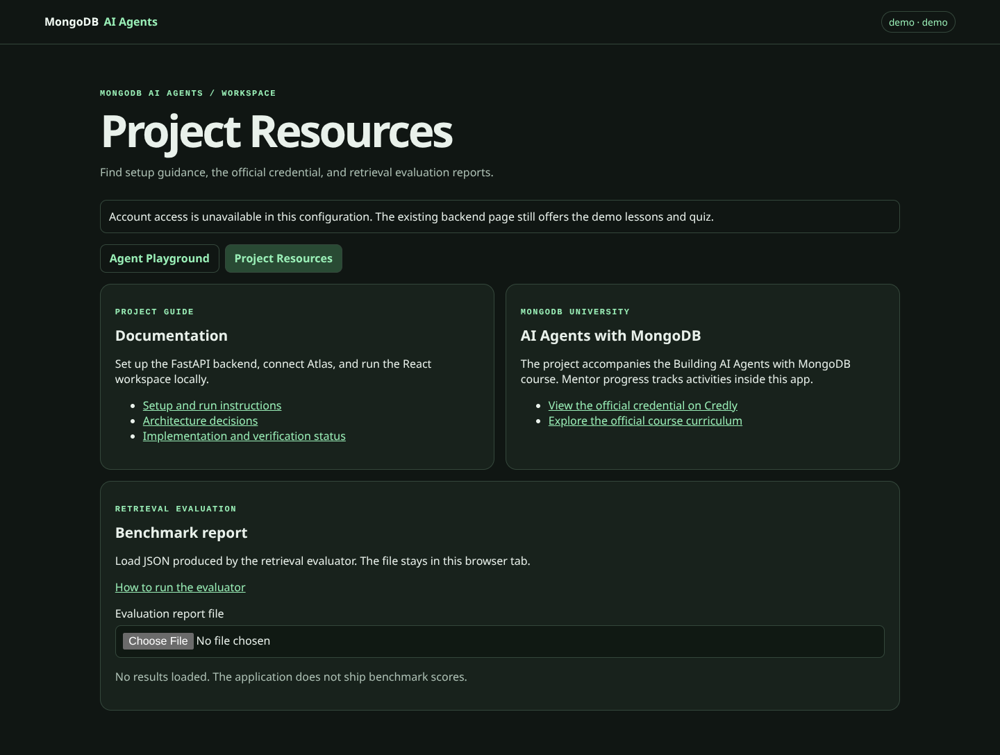
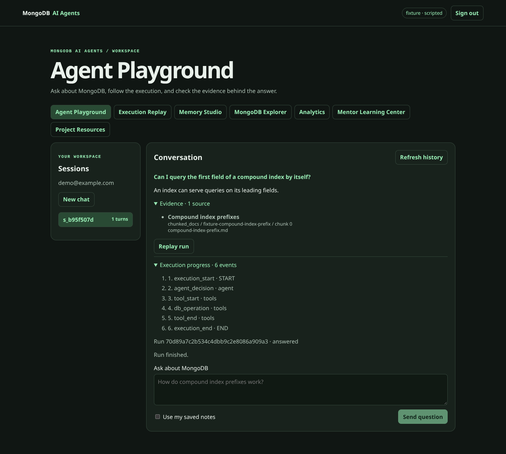
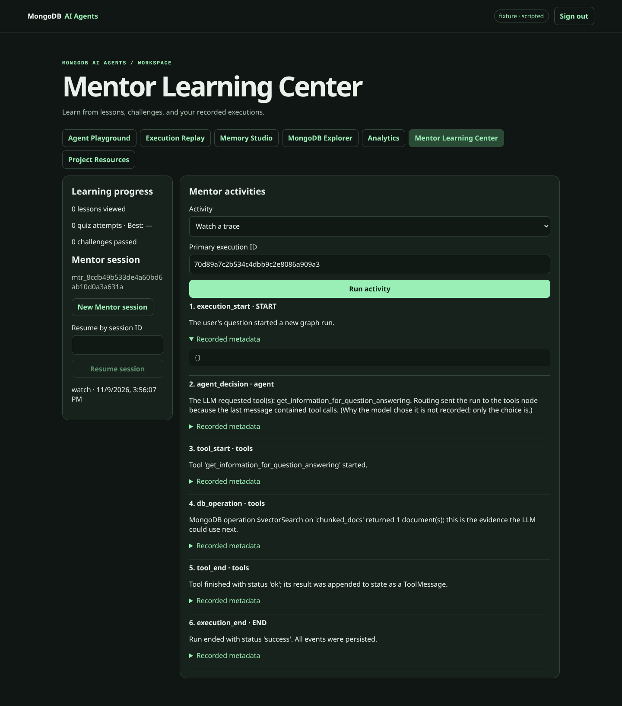

# Release evidence

Session 16 is the last planned implementation session. This page separates
observed checks from verification that requires external services.

| Area | Evidence | Verification boundary |
|---|---|---|
| Backend | Clean checkout, fresh Python 3.12 environment, 292 tests passed, Ruff and Mypy passed | The real MongoDB checkpoint test was skipped without `TEST_MONGODB_URI` |
| React | Clean `npm ci`, 7 tests passed, TypeScript and Vite production build passed | Browser flow checks used the environments described below |
| Browser demo | Chromium opened the credential-free React workspace and Project Resources | The demo has no authenticated chat |
| Signed-in workspace | Chromium registered a test user, streamed a chat result, opened evidence and Replay, and opened the run in Mentor. The Mentor view fit a 390-pixel viewport without horizontal overflow | Local FastAPI used mongomock and a scripted primary run. No Atlas, Voyage, or OpenAI calls were made |
| GitHub Actions | The [Session 15 workflow](https://github.com/DharmiSapariya/AI-Agents-with-MongoDB-Certification/actions/runs/42649184362) passed on `55d00a3` | The container job built and started the demo stack on GitHub. The live deployment path remains unverified |
| Retrieval comparison | The evaluator and viewer support separate vector and agent reports | No live benchmark metrics were generated for this release pass |

## Browser captures

**Project Resources in credential-free demo mode**

**Agent Playground using the scripted local fixture**

**Mentor interpreting events from that same scripted fixture**

The two signed-in captures display `fixture · scripted` in the application
header. The test used the actual React UI, FastAPI routes, and deterministic
Mentor workflow. The primary response and tool events were synthetic.

## Remaining verification

- Run the [live walkthrough](DEMO.md#live-walkthrough) with an isolated Atlas
  corpus, Voyage embeddings, and OpenAI.
- Run the opt-in checkpoint test with `TEST_MONGODB_URI` and verify a full
  FastAPI process restart on the intended deployment.
- Run both retrieval strategies against the same corpus and publish the
  resulting JSON if you want to cite measured performance.
